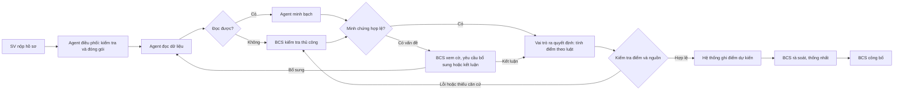

# Thiết kế AI cho hệ thống chấm điểm rèn luyện — bản triển khai V1

**Cơ sở:** BPMN To-Be v7 tại `C:/Users/ADMIN/Downloads/Nhom8_TOBE_NangCao_BPMN20.bpmn`, bản đồ Chương 3 tại `../../output/Ban_do_AI_cho_BPMN_ToBe_Chuong3.md`, bộ quy tắc điểm rèn luyện toàn trường đã được người phụ trách dự án xác nhận ngày 25/10/2026, và backend FastAPI hiện có. Các tiêu chí `TC01`–`TC03` trong `contracts/seed-fixtures.json` chỉ là dữ liệu minh họa.

**Quyết định bổ sung cho V1:** AI phải đánh giá tính phù hợp và các dấu hiệu hợp lệ của minh chứng, đặc biệt chứng nhận online ở mục 7b, kèm căn cứ và trạng thái chưa thể xác minh khi cần. Mọi điểm sinh viên tự khai trên 0 ở các mục 8a–8c đều được đánh cờ để Ban cán sự xác minh và chốt; sinh viên không bị chặn tự khai vì chưa có chức vụ được xác nhận trong hệ thống. Không bật tự duyệt cho các mục này.

**Tiến độ hạ tầng thử nghiệm:** Migration `003_ai_review_runs` thêm lượt chạy và hai bước có thứ tự. Ban cán sự có thể tạo/xem lượt chạy theo phiên bản hồ sơ qua API; `internal/ai-tick` xử lý hàng chờ và trả về chế độ duyệt thủ công khi cờ AI tắt. Giao diện trạng thái chỉ hiện khi `VITE_AI_REVIEW_ENABLED=true`. Các lượt cũ được đánh dấu hết hiệu lực khi hồ sơ hoặc quy tắc thay đổi. Chưa có lịch gọi `ai-tick` trên Supabase; không bật cờ giao diện ở production trước khi nối mô hình và lịch chạy.

**Cập nhật thử nghiệm `AI_Read`:** Nhà cung cấp được chọn là Google Gemini; cấu hình hiện dùng `gemini-3.5-flash-lite` cho trích xuất dữ kiện từ PDF/JPG/PNG. Backend kiểm tra hash, yêu cầu dữ kiện kèm trang và trích đoạn, lưu đầu ra theo từng tệp. Nút upload và nút phân tích có khóa bấm lặp, hiển thị trạng thái chờ. `AI_READ_ENABLED=false` và `VITE_AI_REVIEW_ENABLED` chưa bật ở bản đang dùng; lịch gọi worker và migration production chưa áp dụng. Khóa đã lưu trong `.env` cục bộ, không đưa lên Git. Kết quả thử model cũ được ghi trong `docs/AI_PILOT_RESULT_2026-10-25.md`; chất lượng OCR của cấu hình mới chưa được đánh giá trên hồ sơ thật.

**Tầng luật đã triển khai cục bộ:** Migration `004_campaign_term_window` thêm ngày bắt đầu/kết thúc học kỳ tùy chọn để so ngày hoạt động theo đúng kỳ đánh giá. Backend kiểm tra mức điểm, yêu cầu minh chứng, SHA-256 trùng giữa các tiêu chí (ngoại lệ 4b), và bắt buộc Ban cán sự xem các mục 8a–8c có điểm tự khai >0. Khi `AI_Read` cung cấp ngày hoạt động, tầng luật so ngày đó với khoảng học kỳ; ngày thiếu hoặc mơ hồ mang trạng thái chưa xác minh. Kết quả hiển thị cho sinh viên và Ban cán sự, đồng thời lưu cùng lượt phân tích. Tầng luật không gọi mô hình và không tự thay điểm hay tự duyệt. Cần cấu hình hai ngày học kỳ trong màn hình quản trị để bật kiểm tra thời gian; các đợt cũ chưa có ngày được báo `NOT_CONFIGURED`. Chưa chạy migration này trên Supabase và chưa đẩy mã lên Git.

**Lớp `AI_Transparency` đã triển khai cục bộ:** Sau `AI_Read`, worker dùng lại `GEMINI_API_KEY`; cấu hình hiện dùng `gemini-3.6-flash` với mức suy luận `medium`. Mỗi tệp có điểm tự khai dương được đối chiếu với mô tả/yêu cầu minh chứng của tiêu chí và tệp gốc; đầu ra gồm `SUPPORTED | FLAGGED | UNKNOWN`, căn cứ trích từ dữ kiện đã đọc, dấu hiệu thị giác, mã điều khoản và giới hạn xác minh. Kết luận thiếu trích dẫn bị hạ về `UNKNOWN`; dấu hiệu đáng ngờ không được coi là đã chứng minh tài liệu giả. Ban cán sự thấy nhận xét và mở tệp gốc để chốt. Bước này chưa tự chấm điểm, chưa xác minh QR/đơn vị cấp qua nguồn ngoài hoặc bật trong production; `AI_TRANSPARENCY_ENABLED=false` trong `.env` cục bộ. Cấu hình 3.7 trước đó tự được Google chuyển sang 3.8; kết quả thử cũ nằm ở `docs/AI_PILOT_RESULT_2026-10-25.md`.

**`SC_Decision` đã triển khai cục bộ:** Bộ tính điểm xác định tạo gợi ý riêng cho Ban cán sự qua `GET /api/v1/bcs/cases/{caseId}/score-suggestions` và lưu bản chụp trong kết quả từng lượt phân tích. Nó đối chiếu mức điểm tự khai với lựa chọn đã cấu hình, quy đổi GPA 4e từ dữ liệu quản trị, chỉ dùng nhận xét minh chứng `SUPPORTED` có trích dẫn, kiểm tra trần từng mục và tổng 100 điểm. Mục có cờ/thiếu căn cứ, 8a–8c điểm dương và hồ sơ mẫu chưa có bộ quy tắc chuẩn không được gợi ý điểm. Tổng gợi ý chỉ hiện khi mọi mục đủ điều kiện. Gợi ý không ghi vào `approved_score` hoặc `proposed_total`; Ban cán sự vẫn lưu điểm, nêu lý do khi sửa và công bố theo luồng hiện có.

**Đề xuất sửa BPMN:** xem [Nhận xét v6 và phương hướng v7](../../output/NHAN_XET_BPMN_V6_VA_DINH_HUONG_V7.md), đặc biệt nhánh chưa đủ căn cứ, quyền BCS chấp nhận khi AI gắn cờ sai và cách đáp ứng Bài 3.3 bằng một tác nhân hỗ trợ có phạm vi hẹp.

## 1. Quyết định kiến trúc

Giữ FastAPI, PostgreSQL và Supabase Storage. BPMN v6 **đặt tên 4 vai trò là agent**, nhưng slide Chương 3 phân biệt rõ tên vai trò với cơ chế AI thực sự. V1 giữ đủ bốn vai trò và đầu ra riêng; `AI_Read` và `AI_Transparency` dùng mô hình để xử lý nội dung khó viết luật. `SC_CheckCompleteness`/điều phối và `SC_Decision` dùng workflow cùng quy tắc xác định. Đây là **một workflow có hai bước AI hỗ trợ**, chưa phải bốn tác nhân tự chủ.

| Agent | BPMN và công việc | Đầu ra và giới hạn |
|---|---|---|
| **1. Điều phối** | `SC_CheckCompleteness`, `SC_Package`, `SC_RequestProof`, `EA_SendAlert`: kiểm tra trường/tệp bắt buộc, đóng gói hồ sơ, kích hoạt bước kế tiếp, theo dõi hạn/lượt bổ sung và báo BCS | Workflow và luật xác định; trạng thái, mục thiếu, thông báo. Không cho mô hình tự chọn đường đi ngoài BPMN |
| **2. Đọc dữ liệu** | `AI_Read`: đọc PDF/ảnh, trích điểm tự khai, tên hoạt động, ngày, đơn vị cấp và dữ kiện trong minh chứng | AI hỗ trợ trích xuất có trang/vị trí nguồn và `readable`; không kết luận hợp lệ hoặc sửa hồ sơ |
| **3. Minh bạch** | `AI_Transparency`: đối chiếu nội dung minh chứng với điều khoản đúng phiên bản; luật kiểm tra trùng tệp chính xác và thời hạn | AI hỗ trợ nhận định `SUPPORTED`, `FLAGGED` hoặc `UNKNOWN` kèm nguồn; vấn đề/thiếu căn cứ chuyển BCS |
| **4. Ra quyết định** | `SC_Decision`: sau khi nhánh minh chứng kết thúc, áp dụng quy tắc điểm/trừ điểm của quy chế cho từng tiêu chí | Bộ tính điểm xác định tạo `draft_score` và lý do tính; BCS rà soát ở `SC_ReviewDraft`, chủ động công bố/chốt điểm |

Điều phối **kích hoạt ba vai trò còn lại** theo các nhánh BPMN, nhưng trình tự và điều kiện đã được thiết kế trước. Đây là mẫu **nối chuỗi (M1)** kết hợp **định tuyến (M2)**, không phải mẫu điều phối viên–thợ (M4), vì số lượng và loại bước xử lý đã biết trước. `SC_Decision` nằm **trước** cuộc họp BCS và phải dùng phép tính xác định như slide 10 yêu cầu. Quy chế và giới hạn điểm là dữ liệu có phiên bản; không cần viết lại toàn bộ chính sách trong prompt hay mã riêng cho từng trường hợp.

AI **không tự học sau mỗi hồ sơ** theo nghĩa trọng số mô hình tự thay đổi. Mỗi lần BCS sửa kết quả được lưu thành phản hồi có nguồn; định kỳ dùng tập phản hồi này để đánh giá, sửa prompt hoặc huấn luyện tinh chỉnh nếu đủ dữ liệu, rồi phát hành phiên bản mới sau khi kiểm thử. Bộ nhớ và truy hồi quy chế không đồng nghĩa với huấn luyện mô hình.

Ví dụ dễ hình dung: sinh viên tải giấy chứng nhận tham gia hoạt động. **Điều phối** kiểm tra đủ trường/tệp và đưa hồ sơ vào luồng. **Đọc dữ liệu** trích tên hoạt động, ngày, đơn vị cấp và trang nguồn. **Minh bạch** đối chiếu nội dung với đúng điều khoản; nếu có vấn đề, BCS xem cờ và quyết định bổ sung hoặc xác nhận mục không hợp lệ. **Ra quyết định** áp dụng mức điểm trong quy chế để tính điểm dự kiến. BCS rà soát điểm đó trước khi công bố. AI không thể tự chứng minh giấy là thật nếu không có nguồn xác minh độc lập.

**Đối chiếu slide Chương 3:** slide 10 dùng AI ở bước cần phán đoán và dùng luật ở bước cần chắc chắn như cộng điểm; slide 25 khuyên tránh tác nhân tự chủ cho chấm điểm học tập. Slide 24 và 40 xác định mẫu điều phối viên–thợ chỉ phù hợp khi mô hình tự chia nhiệm vụ chưa biết trước; BPMN v6 đã định trước đường đi. Hai bước `AI_Read` và `AI_Transparency` có thể bắt đầu bằng mẫu 0 (một lời gọi mô hình có dữ liệu/công cụ), nối thành mẫu 1. Mẫu 2 áp dụng khi phân loại AI ảnh hưởng đến nhánh xử lý, như tại `SC_GValid`; không phải mọi gateway XOR đều là AI routing. Gọi một service task là “agent” trong BPMN không làm nó có đủ sáu thành phần của một tác nhân tự chủ ở slide 26–32.

## 2. Luồng xử lý

1. Trong pilot, BCS bấm “Chạy phân tích AI” để tạo `ai_review_run`. Khi sau này bật tự động, lần nộp/bổ sung của sinh viên tạo run **trong cùng giao dịch DB** với hồ sơ. Run gắn `case_id`, `case.version`, danh sách `(evidence_file_id, sha256, version_no)` và `rubric_version`. Worker chỉ thấy run sau khi giao dịch đã commit; không mất việc nếu request chết ngay sau commit.
2. Workflow điều phối nhận hồ sơ tại `SC_CheckCompleteness` → `SC_GComplete`, kiểm tra mục thiếu và tạo gói dữ liệu chuẩn tại `SC_Package`. Backend thực thi điều kiện chuyển nhánh và giới hạn `maxInfoRounds`, rồi gọi bước đọc dữ liệu tại `AI_Read` và bước minh bạch tại `AI_Transparency`.
3. Nếu không đọc được tệp, đi `SC_AIError` → BCS kiểm tra thủ công. Nếu minh chứng có vấn đề, đi `SC_Flag` → `SC_BCSFlags`; chỉ khi BCS yêu cầu và `proofRound < maxProofRounds` mới gửi yêu cầu bổ sung, rồi đọc lại tệp mới. BCS có thể xác nhận mục không hợp lệ tại `SC_InvalidConclusion`.
4. Khi kiểm tra xong, workflow gọi bộ tính điểm tại `SC_Decision`. Bộ này áp dụng điều khoản và công thức đã cấu hình, ghi **điểm dự kiến** tại `SC_Draft`. Sau khi xử lý các sinh viên, BCS họp và rà soát tại `SC_MeetBCS` → `SC_ReviewDraft`, rồi họp lớp và chủ động công bố tại `SC_PublishDraft`.
5. Mỗi đầu ra phải qua Pydantic schema. Trước khi ghi, worker kiểm tra lại phiên bản hồ sơ, hash tệp và phiên bản quy chế; nếu đã đổi thì đánh dấu `STALE` và chạy lại. Không giữ giao dịch DB trong lúc gọi mô hình.

`UNKNOWN`/thiếu căn cứ là trạng thái kỹ thuật **đề xuất thêm khi triển khai**, chưa có nhánh riêng trong BPMN v6. Tạm dừng để BCS xử lý, không tự ép thành `evidenceValid=false` hoặc kết luận minh chứng không hợp lệ. Nếu muốn BPMN mô tả đầy đủ tình huống này, cần bổ sung một nhánh xem xét thủ công riêng sau `AI_Transparency`; đây là điều chỉnh tùy chọn, không liên quan đến số lượng 4 agent.

Nút chạy thủ công trong pilot là cách kích hoạt thử nghiệm của web, không phải một task mới trong BPMN. Khi triển khai quy trình tự động đầy đủ, điều phối được kích hoạt sau nộp/bổ sung đúng theo sơ đồ.



Không chạy mô hình đồng bộ trong request nộp hồ sơ. Trên Vercel, xử lý theo từng run ngắn qua endpoint nội bộ có `CRON_SECRET`; trạng thái và retry nằm trong PostgreSQL. Tách endpoint AI khỏi deadline tick hiện tại để lỗi mô hình không làm ngừng xử lý hạn.

## 3. Hợp đồng kết quả AI

Một run có trạng thái `QUEUED | RUNNING | COMPLETED | NEEDS_HUMAN | FAILED | STALE`, `attempt_count`, `lease_until`, `provider`, `model`, `prompt_version`, `started_at`, `finished_at`, `error_code` và khóa idempotency `(case_id, case_version, rubric_version, evidence_fingerprint)`.

Kết quả đọc tệp cho mỗi minh chứng:

```json
{
  "evidence_file_id": "uuid",
  "sha256": "64 hex chars",
  "readable": true,
  "facts": [
    {
      "field": "event_date",
      "value": "2026-09-15",
      "source": { "page": 1, "quote": "Ngày 15/09/2026" },
      "confidence": 0.88
    }
  ],
  "limitations": []
}
```

Kết quả đối chiếu cho mỗi tiêu chí gồm `verdict = SUPPORTED | FLAGGED | UNKNOWN`, `reason`, `evidence_file_id`, vị trí/trích đoạn minh chứng, `rule_clause_id`, trích đoạn điều khoản, `confidence` và `requires_human_review`. `UNKNOWN` là trạng thái riêng; không ép thành `evidenceValid=false`. Điểm tin cậy không tự quyết định mức điểm và ngưỡng chỉ được chọn sau khi đo trên bộ mẫu đã gắn nhãn.

Vai trò ra quyết định xuất từng mục `{criterion_code, draft_score, applicable_clause_ids, evidence_file_ids, reason, calculation}` và tổng điểm. Bộ tính điểm lấy mức điểm/điều kiện đã cấu hình theo phiên bản quy chế, cộng trừ bằng mã xác định, kiểm tra giới hạn và từ chối đầu vào thiếu kết luận cần thiết. BCS rà soát kết quả. Có thể xây bộ tính điểm dùng chung từ bảng quy tắc, tránh viết nhánh Python riêng cho từng tiêu chí.

## 4. Dữ liệu cần thêm

- `ai_review_runs`: lưu lần chạy, snapshot đầu vào, trạng thái, phiên bản mô hình/prompt, kết quả JSON có schema, thời gian và lỗi. Không ghi đè kết quả cũ.
- `ai_agent_steps`: một bản ghi cho mỗi vai trò/bước điều phối/đọc/minh bạch/ra quyết định, gồm `bpmn_task_id`, `implementation_kind` (`WORKFLOW | AI_ASSISTED | RULE_ENGINE`), phiên bản mô hình/prompt khi có, đầu vào/đầu ra, trạng thái, thời điểm và lỗi.
- `score_suggestions`: V1 lưu bản chụp gợi ý, lý do, điều khoản và phép tính trong `ai_review_runs.result_json`, gắn `case_version` và `rubric_version`; API có thể tính lại theo hồ sơ hiện hành khi chưa có lượt AI. Chỉ tách bảng riêng nếu cần truy vấn hoặc kiểm toán từng dòng độc lập; không dùng chung cột điểm BCS đã duyệt.
- `rubric_versions` và `rubric_clauses`: quy chế chính thức, ngày hiệu lực, điều khoản, mã tiêu chí, nguồn tài liệu và checksum. Một campaign phải chỉ tới đúng một phiên bản trước khi bật AI.
- `ai_feedback`: lưu kết quả BCS chấp nhận/sửa/bác bỏ, điểm dự kiến và điểm BCS xác nhận, lý do sửa, phiên bản mô hình/prompt/quy chế; chỉ dùng để đánh giá và cải thiện phiên bản sau.
- `approved_case_examples`: các hồ sơ mẫu đã ẩn danh và được BCS duyệt cho mục đích đánh giá/tham khảo ở bước AI minh bạch. Ví dụ cũ không được thay thế điều khoản hiện hành hay quy tắc tính điểm.
- Audit event cho enqueue, hoàn tất, lỗi, chạy lại và thao tác BCS với nhận xét. Không lưu khóa API hay toàn bộ tệp trong log.

Nguồn đang dùng là hai tệp Word/Excel tại `../../output` và bảng ánh xạ `docs/CRITERIA_MAPPING_49K14.1.md`. Người phụ trách dự án đã xác nhận bộ quy tắc này được duyệt áp dụng toàn trường; cần gắn đúng phiên bản và nguồn cho mỗi nhận xét AI. Ba tiêu chí seed `TC01`–`TC03` vẫn chỉ là minh họa cho campaign cũ.

V1 tra điều khoản theo `rubric_version + criterion_code`, không cần kho vector khi quy chế còn nhỏ và tiêu chí có mã rõ ràng. Nếu sau này quy chế lớn/nhiều phụ lục, có thể thêm tìm kiếm ngữ nghĩa nhưng vẫn phải trả đúng `rule_clause_id` và trích đoạn gốc.

| Kiểm tra | Cơ chế |
|---|---|
| Có đủ trường và tệp bắt buộc, đúng loại/dung lượng | Luật hiện có |
| Điểm trong giới hạn, tổng điểm và hạn nộp | Quy tắc điểm và kiểm tra số học/ngày xác định theo quy chế |
| Trùng tệp y hệt | So sánh SHA-256; trùng nội dung khác định dạng chỉ là cờ để BCS xem |
| Đọc chữ/ảnh và hiểu nội dung hoạt động | Mô hình/OCR |
| Minh chứng có liên quan điều khoản và nên được bao nhiêu điểm | AI minh bạch đánh giá liên quan có nguồn; bộ tính điểm áp dụng mức quy định; BCS rà soát |

## 5. API và giao diện dự kiến

- `POST /api/v1/bcs/cases/{caseId}/ai-reviews`: BCS yêu cầu phân tích/chạy lại; nhận `202` và `run_id`. Chống tạo trùng cho cùng snapshot.
- `GET /api/v1/bcs/cases/{caseId}/ai-reviews/latest`: trả trạng thái, nhận xét, nguồn và thông báo `STALE` khi hồ sơ đổi.
- `GET /api/v1/bcs/cases/{caseId}/ai-reviews/{runId}`: xem bản cũ để kiểm toán.
- `POST /api/v1/internal/ai-tick`: worker đã xác thực bằng bí mật riêng, xử lý một số run giới hạn mỗi lượt.

Màn BCS `BcsCaseDetail` thêm thẻ “Hỗ trợ xử lý hồ sơ” với trạng thái và kết quả riêng của **4 vai trò BPMN**: điều phối, đọc dữ liệu, minh bạch, ra quyết định. Mỗi nhận xét AI mở đúng tệp, trang và điều khoản. Điểm do bộ tính điểm tạo được lưu/hiển thị như `draft_score` cùng từng phép tính và phiên bản quy chế; không ghi đè `approved_score`. BCS có thể sửa điểm dự kiến, ghi lý do và xác nhận ở bước rà soát; sinh viên chỉ thấy điểm sau khi BCS công bố.

**Điểm nối trong code hiện tại:** `api/app/services/workflow_service.py` đang gọi `ManualReviewProvider` trong lúc nộp hồ sơ rồi bỏ kết quả; cần thay bằng việc thêm run vào cùng giao dịch mà `api/app/routes/student.py` commit, không gọi mô hình tại đây. `api/app/routes/bcs.py` đang trả `review_mode="MANUAL"` cố định; sẽ đọc trạng thái run đã lưu. `api/app/services/remote_storage.py` đã có đường đọc tệp riêng tư để worker sử dụng. `api/app/services/scoring_service.py` triển khai `SC_Decision` bằng quy tắc/công thức xác định theo phiên bản quy chế; các API BCS giữ quyền rà soát, điều chỉnh và công bố.

## 6. Ranh giới an toàn

- Tệp sinh viên và văn bản trích từ tệp là **dữ liệu không tin cậy**, không được dùng làm chỉ dẫn cho mô hình hoặc công cụ.
- Chỉ tải tệp qua backend sau khi kiểm tra quyền; chỉ gửi phần dữ liệu cần thiết cho mô hình. Không đưa khóa Supabase hoặc thông tin đăng nhập vào prompt/browser.
- Giới hạn số tệp, trang, kích thước, số lần retry và chi phí mỗi run. Lỗi/timeout phải hiện rõ cho BCS và không chặn luồng duyệt thủ công.
- Mô hình chỉ trả dữ kiện và nhận xét minh chứng có nguồn; không có quyền trực tiếp ghi DB, gửi thông báo, xuất bản hay chốt bảng. Bộ tính điểm xác định ghi `draft_score` sau khi kiểm tra phiên bản quy chế và kết luận đầu vào; BCS giữ quyền rà soát/công bố, mọi thay đổi có audit.
- Khi bổ sung quy chế hoặc thay prompt/model, tạo phiên bản mới và chạy lại bộ đánh giá trước khi áp dụng.

## 7. Thứ tự triển khai và điều kiện đạt

| Giai đoạn | Việc làm | Điều kiện đạt |
|---|---|---|
| A — Dữ liệu chuẩn | Nhận quy chế thật, ánh xạ điều khoản, tạo hồ sơ PDF/JPG/PNG mẫu đã ẩn danh và nhãn BCS | Có nguồn cho mọi tiêu chí được AI đối chiếu; có ca đúng, sai, mơ hồ, khó đọc |
| B — Điều phối và hạ tầng | Schema/migration, API run, worker idempotent, workflow điều phối và trạng thái UI của 4 vai trò | Đi đúng các nhánh BPMN, giới hạn vòng bổ sung, xử lý stale/retry và manual fallback |
| C — Đọc tệp | Adapter mô hình, trích xuất có nguồn, xử lý PDF và ảnh, kiểm tra schema | Mỗi fact có `evidence_file_id` và vị trí; tệp không đọc được chuyển người |
| D — Minh bạch | AI hỗ trợ tra điều khoản theo mã tiêu chí/phiên bản và đối chiếu; backend kiểm tra trùng hash/ngày hạn theo dữ liệu rõ ràng | Mỗi cờ có nguồn tệp và điều khoản; thiếu nguồn trả `UNKNOWN` |
| E — Ra quyết định | Bộ quy tắc tại `SC_Decision` tính điểm theo quy chế đã cấu hình; lưu `draft_score`, nối màn BCS rà soát | Có điểm dự kiến và phép tính giải thích được; BCS vẫn là người sửa, công bố và chốt |
| F — Pilot và cải thiện | Chạy shadow mode trên hồ sơ mẫu, đo sai sót/chi phí/thời gian; lưu phản hồi BCS rồi đánh giá phiên bản mới | Điểm dự kiến thử nghiệm không tự công bố; nhận xét và điểm sai được phát hiện/ghi lại; phiên bản mới được kiểm thử trước khi bật |

Ở giai đoạn B–F, giữ `ManualReviewProvider` làm fallback. Không bật tự động enqueue cho mọi hồ sơ trước khi pilot đạt; BCS bấm chạy AI trước.

## 8. Quyết định về mô hình và đánh giá

Giữ một adapter `ModelProvider` để có thể đổi nhà cung cấp. Không chốt tên mô hình, giá hoặc ngưỡng confidence khi chưa biết nhà cung cấp và chưa có dữ liệu mẫu. Nếu dùng OpenAI, tài liệu chính thức xác nhận Responses API nhận PDF với cả văn bản và ảnh trang, và Structured Outputs hỗ trợ đầu ra theo JSON Schema; vẫn phải kiểm tra nguồn/căn cứ ở tầng ứng dụng. Tham khảo: [File inputs](https://developers.openai.com/api/docs/guides/file-inputs), [Structured Outputs](https://developers.openai.com/api/docs/guides/structured-outputs), [Evals](https://developers.openai.com/api/docs/guides/evals).

Vòng cải thiện: BCS sửa nhận xét/điểm → lưu `ai_feedback` → chọn và ẩn danh ca đã xác nhận → đưa vào `approved_case_examples` để bước AI minh bạch tham khảo ở các lần chạy sau → đo lại trên bộ kiểm thử cố định. Khi thay prompt, tập ví dụ hoặc mô hình, tăng phiên bản và chỉ phát hành nếu kết quả đạt ngưỡng đã thống nhất. Đây là cách cải thiện AI từ phản hồi trong V1; không cho mô hình tự đổi quy chế, tự chấm điểm hay tự huấn luyện trực tiếp trên mọi hồ sơ mới.

Bộ pilot nên có ít nhất 30 hồ sơ/tệp đã ẩn danh, gồm tài liệu thật và ca cố ý gây lỗi. Hai người gắn nhãn độc lập cho tính đọc được, dữ kiện, điều khoản áp dụng và cờ cần BCS xem. Đo độ đúng trích xuất, tỷ lệ cờ sai, tỷ lệ bỏ sót, tỷ lệ `UNKNOWN`, độ đầy đủ của trích nguồn, thời gian và chi phí. Các ngưỡng chấp nhận được chốt sau pilot, không lấy ví dụ 0,95 trong slide làm mặc định.

## 9. Việc đang chờ đầu vào

1. Quy chế/biểu điểm chính thức áp dụng cho đợt đánh giá, gồm bản có ngày hiệu lực.
2. Tệp minh chứng mẫu đã ẩn danh và kết luận chuẩn của BCS/GVCN.
3. Nhà cung cấp mô hình và ngân sách thử nghiệm; thiết kế adapter không phụ thuộc lựa chọn này.
4. Hoàn tất vòng upload/xem tệp trên Vercel và thay mật khẩu DB từng bị commit trước khi đưa dữ liệu sinh viên thật vào AI.
